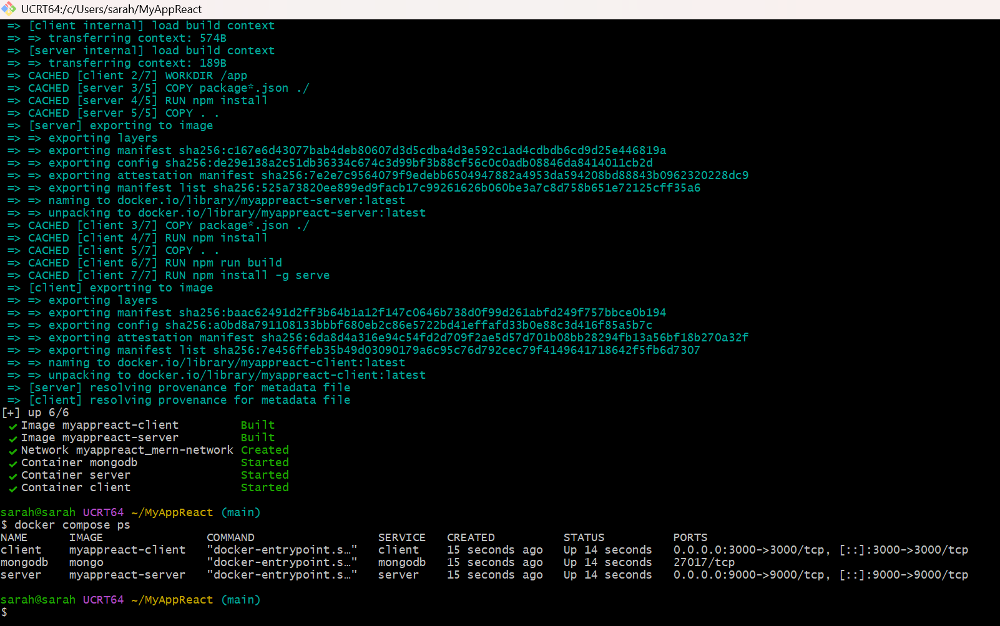
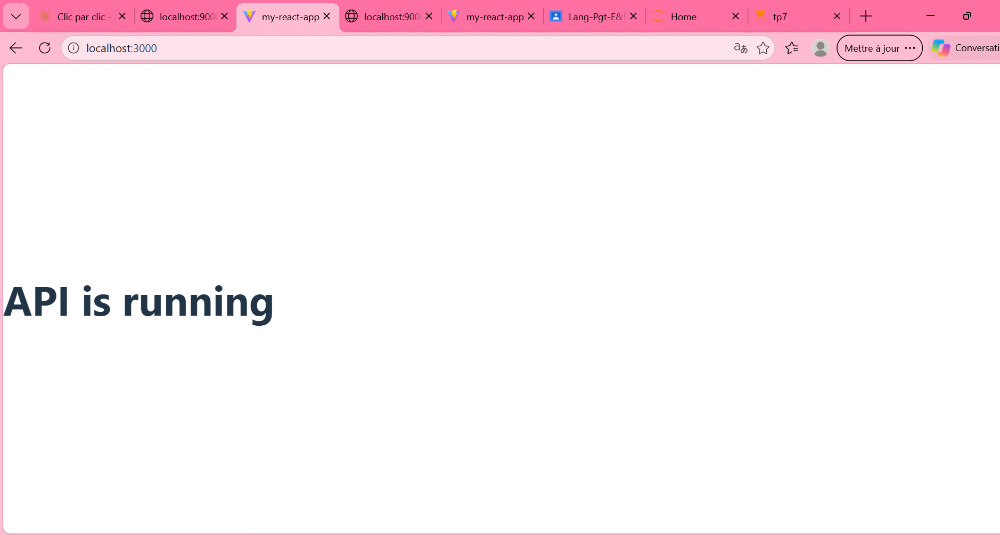
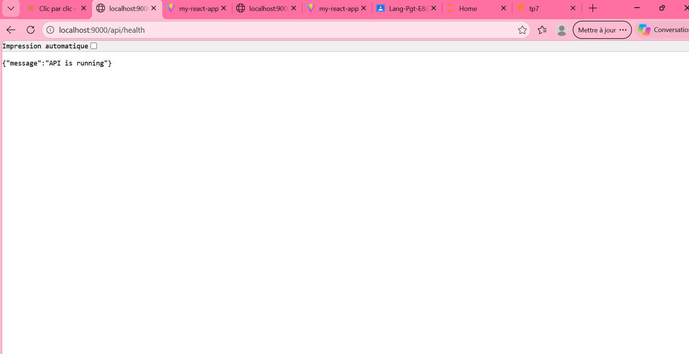

# TP4 : Docker et Docker Compose (application MERN)

## Description
Containerisation d'une application MERN : client React (Vite), serveur Express et base MongoDB.

## Prérequis
- Docker Desktop (Docker et Docker Compose)
- Git

## 1. Cloner le projet
```bash
git clone https://github.com/wiem-kb/MyAppReact.git
cd MyAppReact
```

## 2. Construire les images
```bash
docker build -t mern-server ./Server
docker build -t mern-client ./Client
```

## 3. Lancement manuel (sans Compose)
```bash
docker network create mern-network
docker run -d --name mongodb --network mern-network mongo
docker run -d --name server --network mern-network -p 9000:9000 -e MONGO_URI=mongodb://mongodb:27017/mern mern-server
docker run -d --name client --network mern-network -p 3000:3000 mern-client
```

## 4. Lancement avec Docker Compose
```bash
docker compose up --build
```

## 5. Accès
- Client : http://localhost:3000
- API : http://localhost:9000/api/health

## 6. Arrêt
```bash
docker compose down
```

## Captures d'écran


